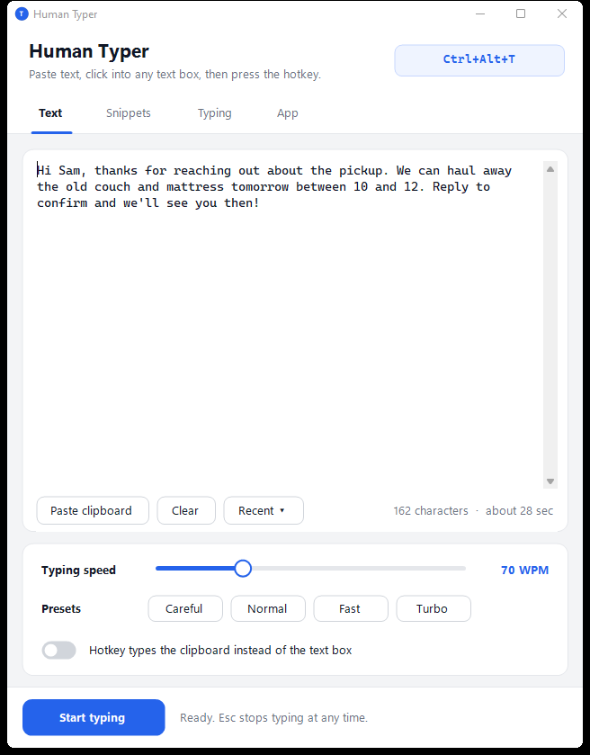
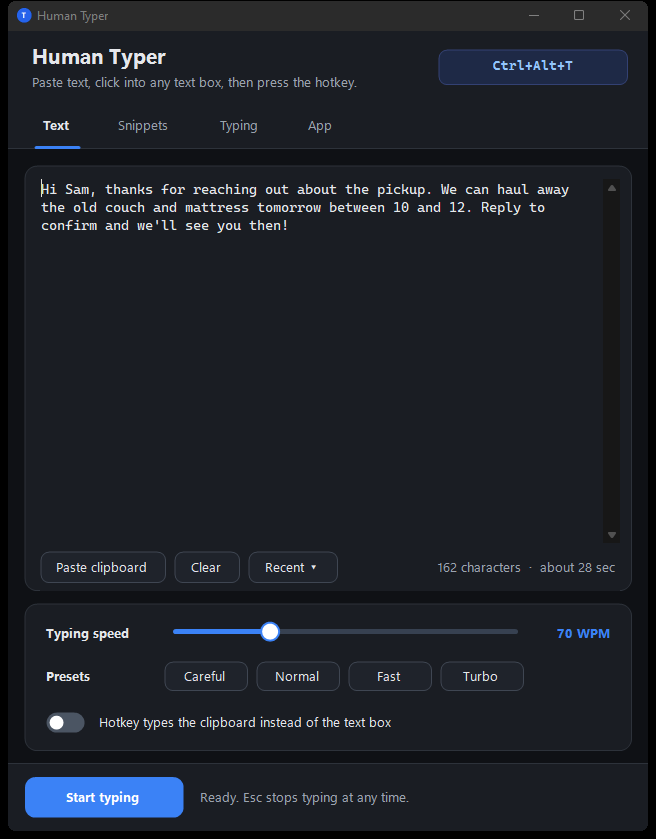
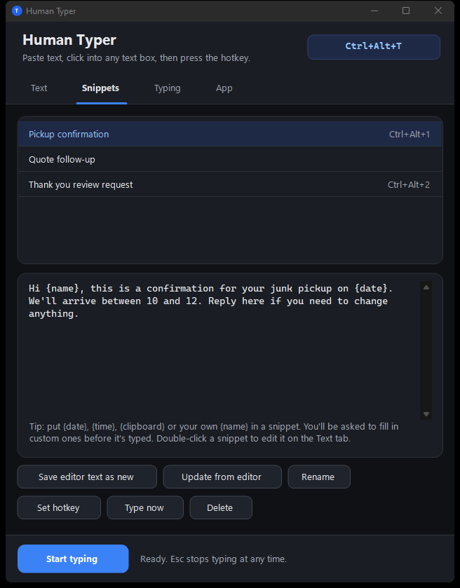
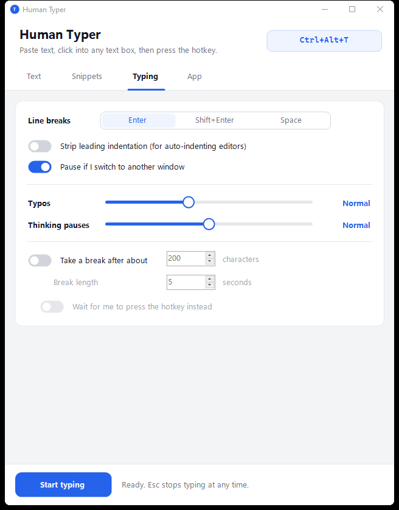
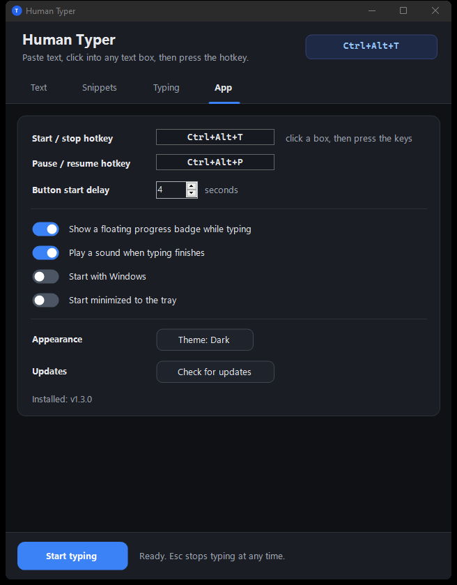

# Human Typer

A tiny Windows app that types text into **any** text box with human-like timing. Paste your text, click into the target field, press a hotkey, and it types it out character by character.

Useful for forms and remote-desktop/VM windows that block pasting, demos, and screen recordings where you want typing to look natural.

<p align="center">
  
  
</p>
<p align="center">
  
  
  
</p>

## Features

**Typing**
- **Global hotkey** (default `Ctrl+Alt+T`) works from any app; change it on the App tab
- **Human-like rhythm**: variable speed (20-200 WPM) that drifts over time, longer pauses after punctuation and new lines
- **Speed presets**: Careful, Normal, Fast, Turbo in one click
- **Typos and thinking pauses**: adjustable from Off to Sloppy; typos hit neighboring keys and get noticed and fixed
- **Type N characters, then pause**: pause for a set time, or wait until you press the hotkey to resume
- **Separate pause / resume hotkey** (default `Ctrl+Alt+P`) so you can pause mid-run without losing your place
- **Pause if I switch windows**: if focus moves away from the target, typing stops until you click back, so text never lands in the wrong place
- **Line breaks**: send them as Enter, Shift+Enter (for chat apps where Enter sends) or a space
- **Strip leading indentation** for auto-indenting code editors
- **Full Unicode**: emoji and accented characters work

**Snippets and history**
- **Saved snippets**: name and store texts you reuse, each with an optional global hotkey
- **Placeholders**: use `{date}`, `{time}`, `{datetime}`, `{clipboard}`, or your own `{name}` in a snippet; you're asked for custom values before typing. Only snippets use placeholders, so ordinary text with braces is never changed
- **Recent texts**: the last 10 texts you typed, one click to reload
- **Clipboard mode**: copy text anywhere and have the hotkey type the clipboard directly

**App**
- **Floating progress badge** while typing, with a paused state
- **Sound and tray notification** when typing finishes
- **System tray**: runs in the background; right-click the icon for the menu
- **Start with Windows** and **start minimized to the tray**
- **Light and dark themes** that follow your Windows setting, or switch manually
- **Check for updates** button (only contacts GitHub when you click it)
- No installer and no dependencies: one small `.exe`

## Download

Grab `HumanTyper.exe` from the [Releases](../../releases) page and run it. Windows SmartScreen may warn about an unsigned app: choose **More info > Run anyway**, or build it yourself from source (below).

## Usage

1. Paste your text into the Text tab (or save it as a snippet).
2. Click into the target text box in any program.
3. Press the hotkey. Press it again, or press `Esc`, to stop.

Settings, snippets and recent texts are saved in `%APPDATA%\HumanTyper\`.

## Build from source

Requires only Windows (uses the .NET Framework compiler included with it):

```
build.bat
```

This compiles every `.cs` file in the folder into `HumanTyper.exe`.

| File | What it holds |
| --- | --- |
| `HumanTyper.cs` | Main window, tabs, theme, tray, hotkey routing, settings |
| `Engine.cs` | The typing engine |
| `TextPage.cs`, `TypingPage.cs`, `SnippetsPage.cs`, `AppPage.cs` | One file per tab |
| `Controls.cs` | Custom flat controls, dialogs, progress badge |
| `Native.cs` | Win32 calls, keystroke sending, settings storage |

## Limitations

- Apps running as Administrator ignore keystrokes from a non-elevated program. Run `HumanTyper.exe` as administrator to type into them.
- Auto-indenting code editors add their own indentation on top of typed text (use "Strip leading indentation").
- If another program already owns a hotkey, pick a different combination on the App tab.

## Responsible use

Don't use this to bypass rules you've agreed to, such as exam or assessment proctoring, or anti-automation terms of a service. You're responsible for how you use it.

## License

[GNU GPL v3.0](LICENSE). You're free to use, modify and share this app, but any distributed modified version must also be released under GPL-3.0 with its source code.
